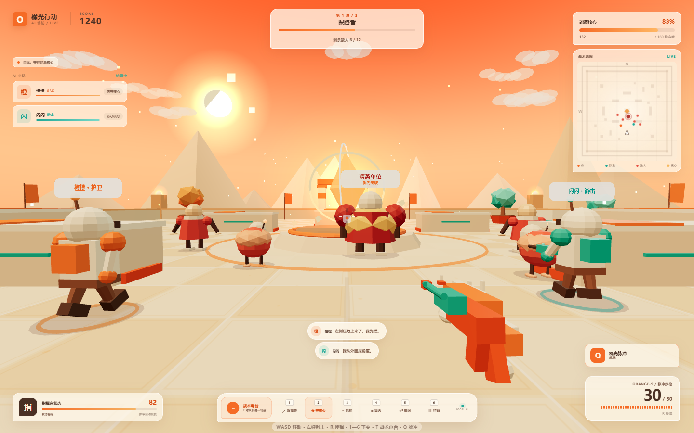
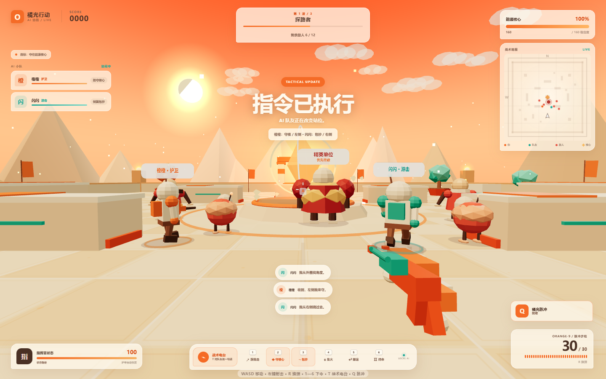

# 橘光行动 · AI 协防（Orange Protocol）

> **用一句中文，指挥两名 AI 队友守住核心。**
> 卡通风格 · 单机合作 · 一局 6—8 分钟 · 纯前端零依赖

参赛作品：**AI+∞ 开发者创作大赛 第三期「AI 造游戏」**

---

## 它是什么

你是「橘光小队」的现场指挥员，和两名 AI 队友 **橙橙（护卫）** 与 **闪闪（游击）** 一起，守住场地中央的能源核心，打退三波机器人进攻。

和普通射击游戏的区别在于：**队友不是跟着你走的木头人。** 你可以在战斗中直接对它们说人话：

```
橙橙守住左边，闪闪从右边包抄
都回来，守住核心
集火那个大块头
闪闪跟我走
```

一句话里点两个名字、下两条不同的命令，它们会各自执行。指令会真实改变它们的站位、目标和开火节奏——**不是聊天框里的装饰**。



---

## 玩法

| | |
|---|---|
| **目标** | 守住能源核心，撑过三波进攻 |
| **失败** | 核心血量归零，或你在倒地状态下没人来救 |
| **胜利** | 三波全部清空 |
| **技能** | `Q` 橘光脉冲：范围击退 + 对周围敌人造成伤害，冷却 20 秒 |

### 三波进攻

| 波次 | 敌人 | 设计意图 |
|---|---|---|
| 第一波 · 探路者 | 5 只蹦蹦虫（近战） | 熟悉射击与指令 |
| 第二波 · 泡泡炮阵 | 3 只蹦蹦虫 + 4 只泡泡炮手（远程） | 逼玩家用「包抄」拆掉远程站位 |
| 第三波 · 大块头登场 | 3 + 3 + 1 只精英守卫 | 精英会顶在前面，需要「集火」 |

### 操作

| 按键 | 作用 |
|---|---|
| `WASD` | 移动 |
| `Shift` | 冲刺 |
| `空格` | 跳跃 |
| 鼠标左键 | 射击（支持爆头判定） |
| `R` | 换弹 |
| `Q` | 橘光脉冲 |
| `1`—`6` | 快捷指令 |
| `T` | 打开战术电台，直接打字／说话下指令 |
| `F` | 长按救援倒地的队友 |
| `Esc` | 暂停 |

---

## 指令系统（核心）

### 六种意图

| 意图 | 队友会做什么 |
|---|---|
| 跟着你 `follow` | 贴着你移动，优先打你面前的敌人 |
| 守核心 `defend` | 回到核心周围环形站位，优先拦截最靠近核心的敌人 |
| 包抄 `flank` | 绕到敌人侧后方，从外圈开火 |
| 集火 `focus` | 锁定同一个目标（可指定「精英／远程／近战」） |
| 撤退 `retreat` | 退回核心圈回血 |
| 待命 `hold` | 停在原地不动，只打射程内的目标 |

### 一句话拆两条命令

解析器会先按标点（`，。；！？`）和连接词（`然后／接着／随后／再`）切分子句，再对每个子句单独识别意图、队友名、方位和敌人类型：

```
输入：橙橙守住左边，闪闪从右边包抄
解析：橙橙 → 守核 / 左侧      闪闪 → 包抄 / 右侧
```



### 队友有记忆

每名队友会记住：

- **哪一侧漏过敌人**（`leaks`）——下一波会主动往那一侧靠
- **你多久没下过指令**、下过几次
- **自己倒地过几次**

战斗间隙它们会主动开口，比如「上次东侧被摸进来了，这次我盯那边」。结算页的「队长点评」也是从这些记忆里生成的，不是写死的文案。

### AI 安全边界

外部大模型**只**参与「把中文映射成六选一的意图」，不参与任何数值：

```
玩家输入 → [本地解析器] → 意图（六选一）+ 目标队友 + 方位
                ↓（可选，失败即降级）
          [远程模型端点] 1.8s 超时
                ↓
        规则系统执行：移动、伤害、命中、波次
```

- 前端**不含任何 API Key**；远程端点为可选配置，未配置时完全走本地解析。
- 白名单校验：模型返回非六种意图之一，直接丢弃并回退本地结果。
- 因此断网、接口挂掉、模型胡说，游戏都不会坏。

---

## 技术实现

- **Three.js r187**（本地 vendor，MIT），WebGL2，**无构建步骤**——浏览器直接加载原生 ES Module。
- **零外部素材**：所有几何体由代码生成；贴图（地面网格、警戒条、地面文字、血条）用 Canvas 2D 现画；音效用 Web Audio 振荡器 + 噪声合成。仓库里没有一张图片、一个音频文件。
- **碰撞**：逐轴扫描 + AABB 障碍，AI 单位额外做前向探测和稳定侧移绕障，避免卡在掩体拐角。
- **命中判定**：`THREE.Raycaster` 打 `hitMeshes`，并单独检测世界遮挡；头部命中按 `userData.actorPart` 给倍率。

### 代码结构

```
index.html            开始页 / HUD / 暂停 / 电台 / 结算，全部 DOM 结构
styles.css            活力橙 + 奶油白 + 青绿主题
src/config.js         数值与波次配置（武器、敌人、队友、三波）
src/utils.js          数学、贴图生成、碰撞、视线、AI 寻路
src/world.js          场地、能源核心、天空、掩体、光尘
src/entities.js       Player / Ally / Enemy / 弹丸 + 第一人称武器模型
src/ai.js             本地指令解析、远程大脑、队友台词
src/ui.js             HUD 与所有界面状态
src/audio.js          Web Audio 程序化音效
src/game.js           主循环、波次状态机、战斗结算、特效
server.mjs            零依赖静态服务器（本地预览 + 容器内服务，MIME 与访问范围可控）
Dockerfile            创空间 Docker 空间构建（node:24-alpine，7860 端口）
checks/               Playwright 真浏览器测试与截图脚本
vendor/               Three.js r187 + 许可证
```

约 5,400 行自有 JS + 2,800 行 CSS + 320 行 HTML。

---

## 本地运行

需要 **Chrome / Edge**（要 WebGL2 与 Pointer Lock）和一个静态服务器。

```bash
cd ai-fps-contest
node server.mjs          # → http://127.0.0.1:8790/
```

也可以用任意静态服务器，例如 `python -m http.server 8790`。**不能**直接双击 `index.html`——ES Module 在 `file://` 下会被 CORS 拦掉。

### 自动化测试

```bash
node checks/flow.mjs       # 31 项真浏览器断言：波次 / 指令解析 / 记忆 / 射击 / 胜败
node checks/soak.mjs       # 长局稳定性：不渲染，用固定步长推进 150 秒，查卡死与波次停滞
node checks/shots.mjs      # 生成 screenshots/ 下的定版截图
node checks/showcase.mjs   # 生成 checks/ 下的展示截图
```

`flow.mjs` 会在真实 Chrome 里跑完整一局，覆盖三波敌人构成、复合中文指令的逐人派发、队友记忆写入、射线命中与弹药消耗、胜利与失败两条结局，并断言全程无 console 报错。

`soak.mjs` 用 `SOAK_SECONDS` 控制时长（默认 150 秒），检查：队友是否卡在掩体上、敌人能否真的推进到核心、是否出现 NaN 坐标、波次是否会停滞。它抓到过一个致命缺陷——敌人因为读错字段名而**从不攻击**，见 `SUBMISSION.md` 4.5 节。

---

## 浏览器与性能

- 目标：桌面 Chrome / Edge，独显或核显均可（i5-1135G7 核显实测流畅）。
- 渲染分辨率上限按设备像素比 1.35 截断，避免高分屏掉帧。
- HUD 按视口宽度等比缩放，1080p / 2K 下比例一致。
- 移动端会显示「请用桌面浏览器」提示，不做触屏适配。

**关于嵌入播放**：魔搭创空间页面的 iframe `allow` 列表里没有 `pointer-lock`，而应用跑在跨域子域上，所以在创空间内嵌窗口里鼠标可能锁不住。游戏检测到后会切成「按住左键拖动视角」并浮出提示条；同时开始页会多出「在新窗口打开」。想要标准 FPS 手感，直接开直链 `https://try888-<空间名>.ms.show/`。部署细节见 `DEPLOY.md`。

---

## 第三方依赖

| 组件 | 版本 | 许可证 | 用途 |
|---|---|---|---|
| [Three.js](https://threejs.org/) | r187 | MIT | WebGL 渲染引擎 |

见 `LICENSES/`。游戏本体的玩法、关卡、AI、界面、美术与音效均为本项目原创。

---

## 开发记录

- `DEPLOY.md`：部署到魔搭创空间（Static）的步骤与验收清单
- `SUBMISSION.md`：参赛手记、创作过程、演示视频脚本、提交清单
- `D:/coding/dailywork/AI造游戏_FPS参赛方案_20261111.md`（仓库外）：立项方案与拿奖策略
